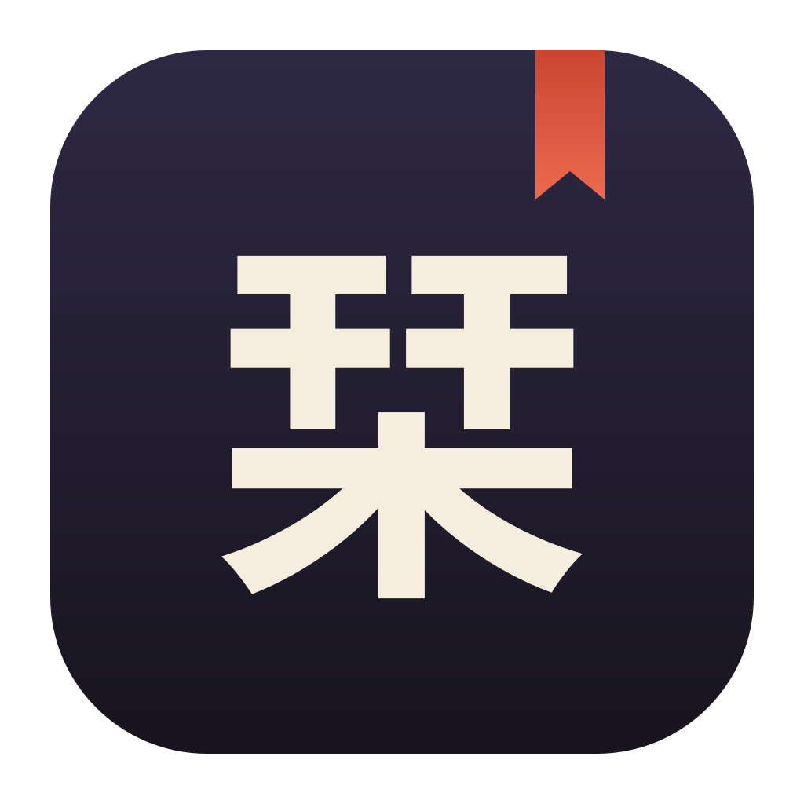

<p align="center"></p>

# Shiori 栞

*Shiori* (栞) is Japanese for a bookmark. It is a desktop app for terminals and coding agents, written in Go with the
[MyGo](https://github.com/egoist/mygo) native UI. It is a re-implementation
of [Herdr](https://github.com/herdrdev/herdr-app) and uses the same backend,
**herdr-core**: terminals run in the core and survive the window, and the
layout lives in the core's `herdr-app` document, so Shiori and
herdr-app can show the same spaces side by side.

## Features

- Spaces, tabs and split panes, with drag-to-resize dividers, zoom and
  directional focus
- Terminals rendered with libghostty-vt through MyGo's terminal plugin
- Agent status (OSC 7501: working, blocked, done) in the sidebar, tabs
  and status bar, with herdr.seen read tracking
- Command palette, rename and confirm dialogs, theme presets
- A settings panel (`Ctrl+,`) for everything in `settings.json` and
  `keys.json`: theme, terminal font and size, sidebar, and every key
  binding, recorded by pressing the keys
- herdr-app's default key bindings (`keys.json` overrides them)
- A control CLI compatible with herdr-app's
  (`shiori do tab.new --argv '["claude"]' --task "..."`)

## Requirements

- Go 1.27 or later (`GOTOOLCHAIN=auto` fetches it)
- herdr-core (`hc`): bundled with the releases; for a source build, on `PATH`.
  The app starts the core if it is not running
- Linux: GTK 3 and OpenGL. macOS 13 or later.

## Install

```sh
curl -fsSL https://raw.githubusercontent.com/duskoide/shiori/main/install.sh | sh
```

The script downloads the release for your OS and CPU (Linux and macOS, amd64
and arm64), checks its SHA-256, and installs `shiori` to `~/.local/bin`. Each
release bundles herdr-core, which goes to `~/.local/libexec/shiori` and is
the core Shiori starts (before any `hc` on `PATH`); `--no-core` skips it. On
Linux it also adds a desktop entry and icon. If there is no release for your
platform, it builds from source with Go and fetches herdr-core with its own
installer. Options go after `sh -s --`:

```sh
curl -fsSL https://raw.githubusercontent.com/duskoide/shiori/main/install.sh | sh -s -- --version v0.1.0 --dir /usr/local/bin
```

`--from-source`, `--no-core`, `--no-desktop`, `--uninstall` and `--help` are also accepted.
While the repository is private, pass a token that can read it:

```sh
curl -fsSL -H "Authorization: Bearer $GITHUB_TOKEN" https://raw.githubusercontent.com/duskoide/shiori/main/install.sh | GITHUB_TOKEN=$GITHUB_TOKEN sh
```

Releases are built by `.github/workflows/release.yml` when a `v*` tag is
pushed (`git tag v0.1.0 && git push origin v0.1.0`): one job per platform
builds `shiori` and bundles the latest herdr-core from
`https://releases.herdr.dev/core/install.sh`.

## Build and run

```sh
make build      # ./shiori
make run
make check      # vet, tests, gofmt (what CI runs)
make package    # platform package via mygo build
```

## Control CLI

With the window open:

```sh
shiori ls                       # spaces, tabs and panes
shiori commands                 # every command and its arguments
shiori do pane.split --direction right
shiori do space.new --name api --folder ~/src/api
```

Commands herdr-app has but this app does not implement answer
"<name> is not supported by this app".

## Files

`$SHIORI_HOME` (default `~/.config/shiori`) holds
`settings.json`, `keys.json` and the control socket. Files of the
app's earlier name, `~/.config/herdr-mygo`, move there on first start. The window reads
`settings.json` and `keys.json` again when they change (within about
half a second), or on `shiori do app.reload`; a file that does not parse
keeps what was in use. `HC_SESSION`
selects the herdr-core session.

| File | Key | What | Settings panel |
| --- | --- | --- | --- |
| `settings.json` | `theme` | `graphite`, `ink`, `moss`, `paper` or `atom-one-dark` | Appearance |
| | `font` | the terminals' font family, or a comma-separated list | Terminal |
| | `font_size` | the terminals' text size, 6 to 40 (default 13) | Terminal |
| | `sidebar` | `false` hides the sidebar | Layout |
| `keys.json` | `{"section": {"chord": "action"}}` | herdr-app's key bindings: `global` and `terminal` here, other sections kept for herdr-app | Keyboard |

The panel writes the files as you change things, and
`shiori do app.settings --section keyboard` opens it at a section
(`appearance`, `terminal`, `layout`, `keyboard`, `files`).

## Layout of the code

| Path | What |
| --- | --- |
| `cmd/shiori` | the command: opens the window, or talks to the open one (`ls`, `status`, `do`) |
| `internal/app` | the window: state, sync with the core, views, commands, control socket |
| `internal/core` | herdr-core client: framing, RPC, events, terminal streams |
| `internal/layout` | the shared layout document: model, edits, geometry |
| `internal/agent` | agent status words and attention |
| `internal/theme`, `internal/programs`, `internal/keys` | themes, program table and icons, key bindings |
| `docs/PROTOCOL.md` | notes on the core's wire protocol |
| `docs/CONTRACTS.md` | the packages' public APIs |
| `docs/MODS.md` | the design of mods (a proposal, not built yet) |
| `assets`, `tools/logo` | the logo and icon, and the script drawing them (`make logo`) |
| `bench` | the performance comparison with herdr-app |

## Tests

`go test ./...` runs the unit tests. The integration test drives the
real window headlessly against an isolated core session
(`HC_SESSION=shiori-it`):

```sh
CGO_ENABLED=0 go test -c -o /tmp/shiori-app.test ./internal/app
SHIORI_IT=1 SHIORI_SHOTS=/tmp/shots /tmp/shiori-app.test -test.run TestIntegration -test.v
```

## License

Apache License 2.0. See [LICENSE](LICENSE) and [NOTICE](NOTICE).
